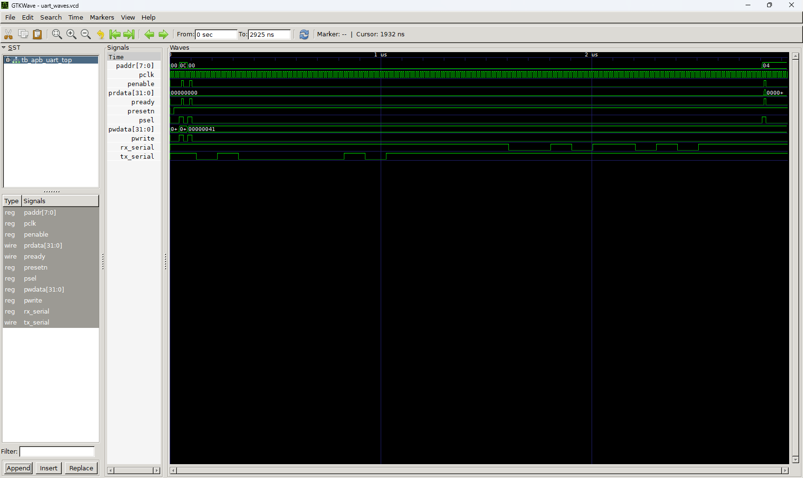

# AMBA APB to UART Controller

## Overview
This repository contains the RTL implementation of an industry-standard **AMBA APB (Advanced Peripheral Bus) to UART Controller**, written in Verilog. It bridges a high-speed parallel memory bus to a slow serial peripheral, mimicking how commercial SoCs integrate peripheral IP blocks.

## System Architecture
The design is split into two primary hardware modules:
1. **APB Slave Interface (`apb_uart_slave.v`):** Handles the standard `PSEL`, `PENABLE`, and `PREADY` protocol handshaking. It decodes 32-bit memory-mapped writes from the CPU and drives the peripheral control signals.
2. **UART TX Engine (`uart_tx.v`):** A custom serial transmission core that accepts parallel 8-bit data, generates the appropriate baud clock pulses based on a programmable divisor, and shifts the data out serially with standard Start and Stop framing bits.

## Memory Map
The CPU controls the UART core by reading and writing to the following memory-mapped registers:

| Byte Offset | Register Name | Access | Width | Description |
| :--- | :--- | :--- | :--- | :--- |
| `0x00` | `UART_TXDATA` | W | 8-bit | CPU writes byte to transmit |
| `0x04` | `UART_RXDATA` | R | 8-bit | CPU reads received byte (Placeholder) |
| `0x08` | `UART_STATUS` | R | 32-bit | Bit 0: `TX_BUSY` flag |
| `0x0C` | `UART_BAUDDIV`| R/W | 16-bit | Programmable clock divisor for baud rate |

## Verification & Simulation
The design was verified using a self-checking Verilog testbench acting as the APB Master. 

Below is the GTKWave simulation demonstrating a successful APB write transaction followed by the UART serial transmission. The Master writes the Baud Rate Divisor to `0x0C`, and then writes the ASCII character 'A' (`0x41`) to the TX Data Register at `0x00`.

*Simulation showing APB Master writing 0x41 to TX, the external serial line injecting 0x5A into RX, and the CPU successfully reading the received byte.*

## Tools Used
* **Design & RTL:** Verilog HDL, Visual Studio Code
* **Simulation:** Icarus Verilog (`iverilog`)
* **Verification:** GTKWave